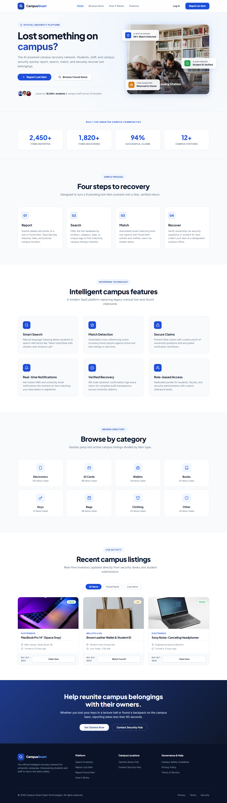
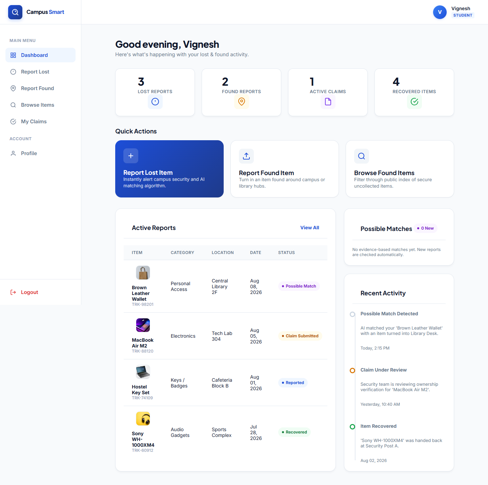
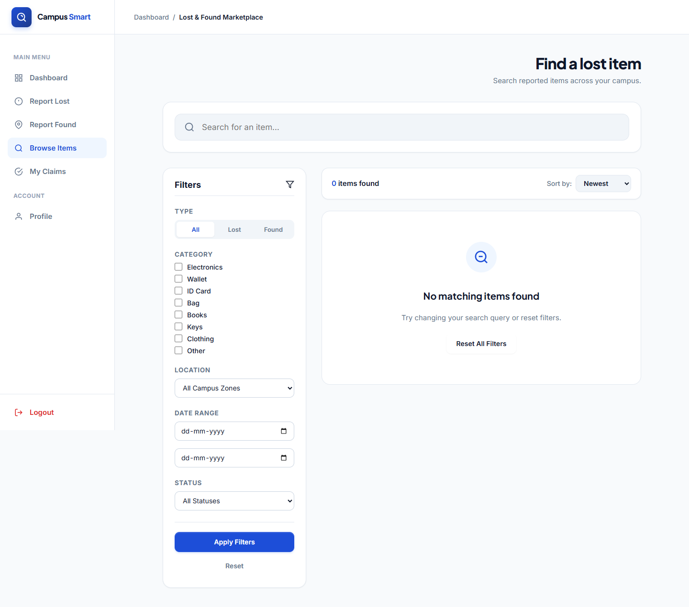
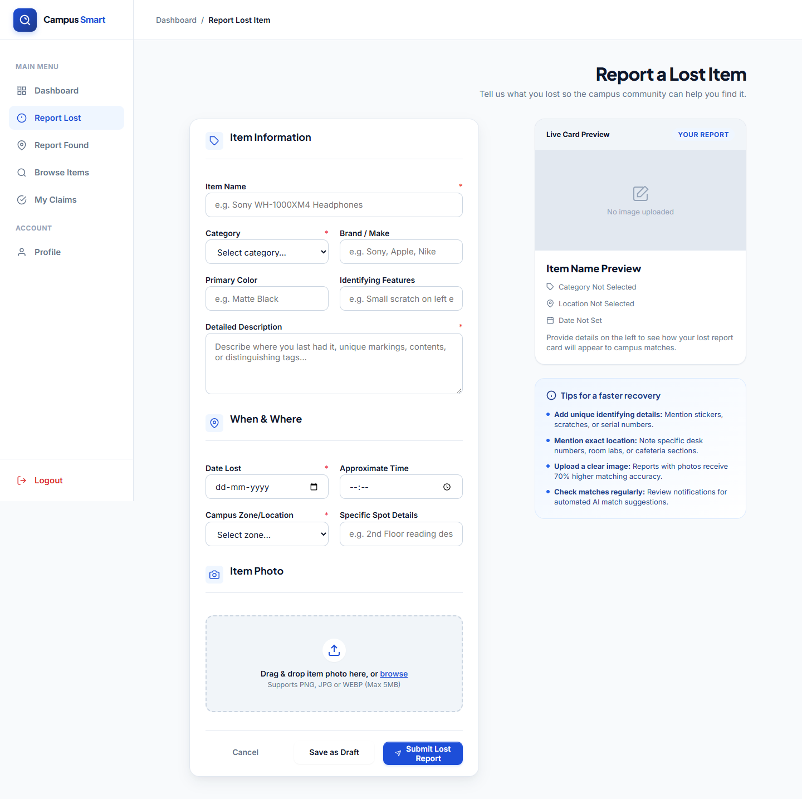
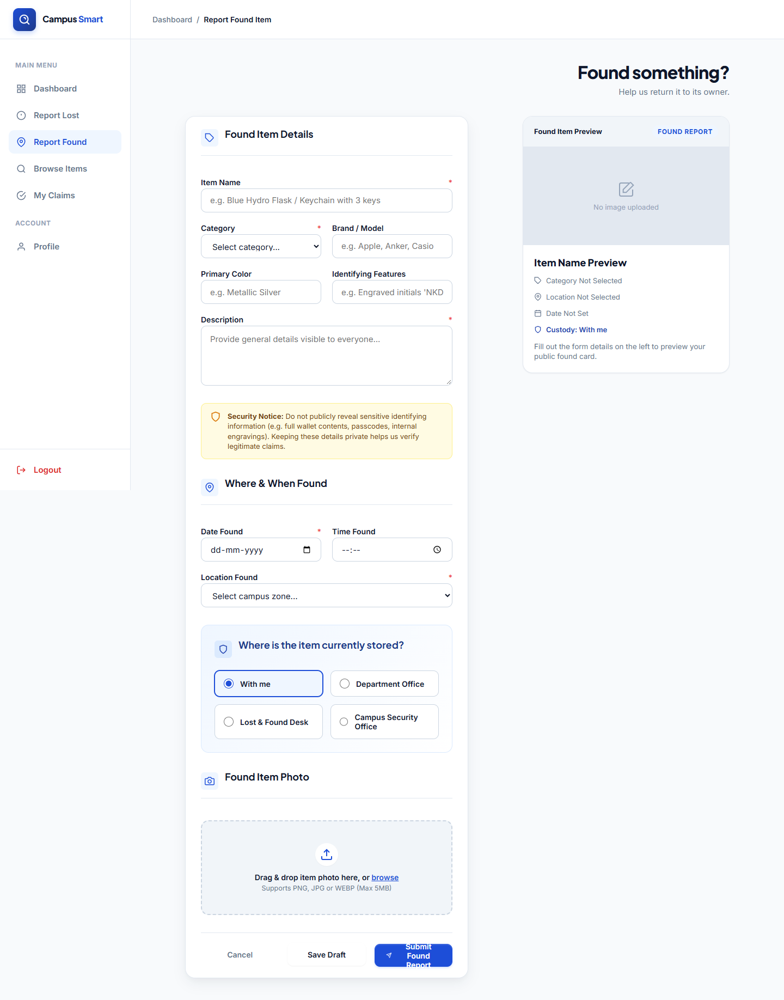
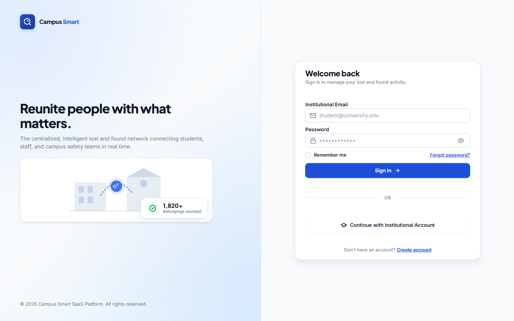
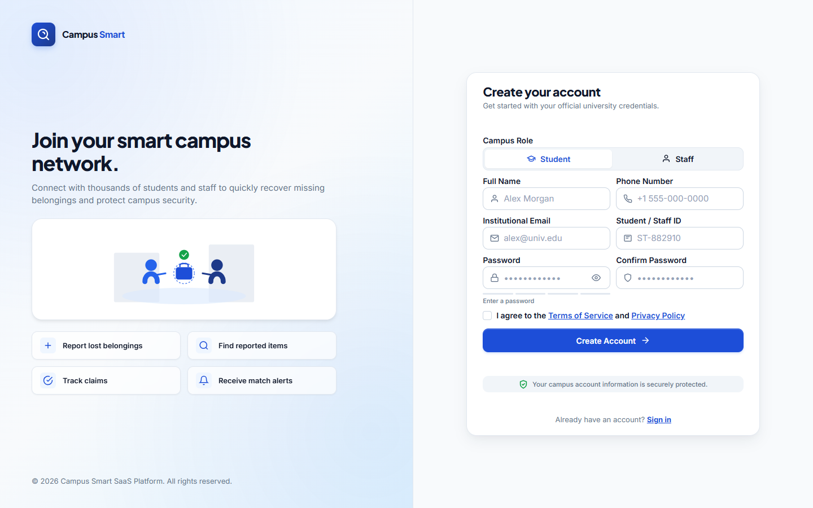
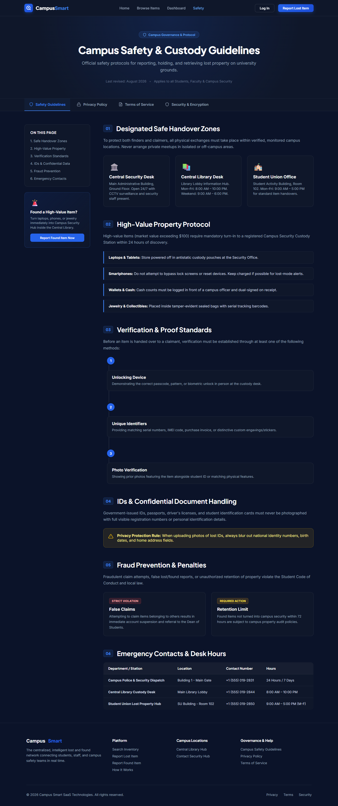
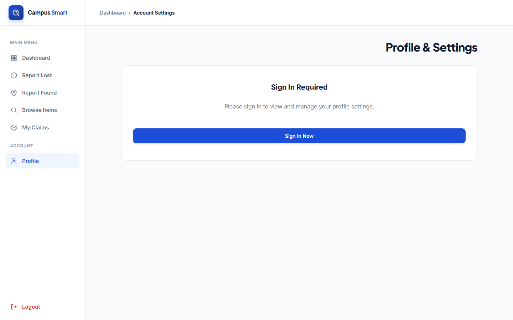
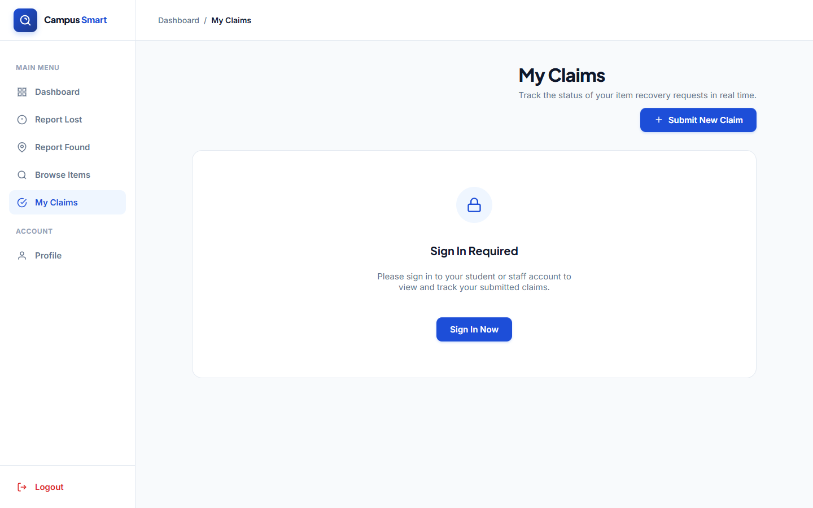

# CampusSmart — Campus Lost & Found

AI-assisted lost-and-found network for university campuses. Students, staff, and campus security report, search, match, and securely recover lost belongings.

## Features

- Report lost items (photo upload with live card preview, validation, drag-and-drop, 5 MB limit)
- Report found items (custody selection, privacy notice, live preview)
- Marketplace / browse items (search, type / category / location / date / status filters, sorting)
- Item detail pages (gallery, specs, description, timeline, similar items)
- Claim workflow (submit claim with ownership proof, My Claims tracking, status drawer)
- Dashboard (stats, quick actions, active reports, match alerts, activity feed)
- Desk dashboard (staff view), Central Library Hub, Contact Security Hub
- Auth (register, login, JWT, protected staff routes, persisted session)
- Safety guidelines, privacy policy, terms of service, security policy pages
- Automated lost-vs-found matching scored on category, brand, color, and keywords

## Tech Stack

- Frontend: React 18, React Router 6, Vite 5
- Backend: Node.js, Express 5, Mongoose 9, JWT, bcryptjs, CORS
- Database: MongoDB Atlas
- Deploy: Vercel (frontend, SPA rewrites in `vercel.json`), Render (backend via `VITE_API_URL`)

## Project Structure

```text
src/
  main.jsx            # routes
  config/api.js       # API base URL (VITE_API_URL or '' for Vite proxy)
  component/          # Sidebar, StatusBadge
  pages/              # App (landing), Dashboard, Marketplace, ItemDetail,
                      # ReportLostItem, ReportFoundItem, ClaimItem, MyClaims,
                      # ProfileSettings, SignIn, Register, DeskDashboard, ...
server/
  index.js            # Express app, CORS, JSON limit, /api/* routes
  config/db.js        # MongoDB connection
  models/             # Item, Claim, User
  routes/             # auth, items, claims
  seed.js             # seed 10 demo items
screenshots/          # app screenshots (see gallery below)
```

## Setup

### 1. Prerequisites

- Node.js 18+ and npm
- MongoDB Atlas connection string

### 2. Install

```bash
npm install
```

### 3. Environment

```bash
cp .env.example .env
```

`.env` values (`server/index.js` reads these):

```text
PORT=5000
MONGODB_URI=mongodb+srv://<username>:<password>@cluster0.xxx.mongodb.net/campus-smart
JWT_SECRET=<strong-secret>
CORS_ORIGIN=https://your-frontend.vercel.app
```

Frontend production backend URL (optional):

```text
VITE_API_URL=https://your-backend.onrender.com
```

If `VITE_API_URL` is unset, the frontend uses relative `/api` paths (Vite dev proxy forwards to `http://localhost:5000`).

### 4. Run

```bash
# frontend only (needs backend running or VITE_API_URL set)
npm run dev

# backend only
npm run server

# both together
npm run dev:full

# production build + preview
npm run build
npm run preview
```

### 5. Seed demo data (optional)

```bash
# with backend running
curl -X POST http://localhost:5000/api/items/seed
```

## API Overview

| Method | Route | Description |
| ------ | ----- | ----------- |
| GET | `/api/health` | Health check |
| POST | `/api/auth/register` | Register user |
| POST | `/api/auth/login` | Login, returns JWT |
| GET | `/api/items` | List items (`search`, `type`, `category`, `location`, `sort`, `page`, `limit`) |
| GET | `/api/items/matches` | Top evidence-based lost-vs-found matches |
| GET | `/api/items/:id` | Single item by Mongo ID or tracking code |
| POST | `/api/items` | Create lost/found report (base64 `imagePreviewUrl` supported, 8 MB JSON limit) |
| PUT | `/api/items/:id/status` | Update status (staff only) |
| POST | `/api/items/seed` | Seed demo items |
| GET/POST | `/api/claims` | Claims endpoints (see `server/routes/claims.js`) |

## App Routes

`/`, `/dashboard`, `/marketplace`, `/item/:id`, `/reportlost`, `/reportfound`, `/submitclaim`, `/myclaims`, `/profile`, `/login`, `/register`, `/safety-guidelines`, `/desk-dashboard`, `/central-library-hub`, `/contact-security-hub`, `/privacy-policy`, `/terms-of-service`, `/security-policy`

## Screenshots

Full-page captures at 1440x900 from the production build. Files live in `screenshots/`.

### Home / Landing



Hero, stats, how-it-works, features, categories, and recent campus listings.

### Dashboard



Stats, quick actions, active reports, possible matches, and recent activity.

### Marketplace (Browse Items)



Search, filters (type, category, location, date, status), and results grid.

### Report Lost Item



Item info, when-and-where, photo upload, and live card preview.

### Report Found Item



Item details, custody selection, photo upload, and live preview.

### Login



Institutional email sign-in.

### Register



New account creation.

### Campus Safety Guidelines



Safety rules and recovery guidance.

### Desk Dashboard (Staff)


Staff-side intake and verification view.

### Profile Settings



Avatar, account details, and user listings.

### My Claims



Claim tracking and detail drawer.
